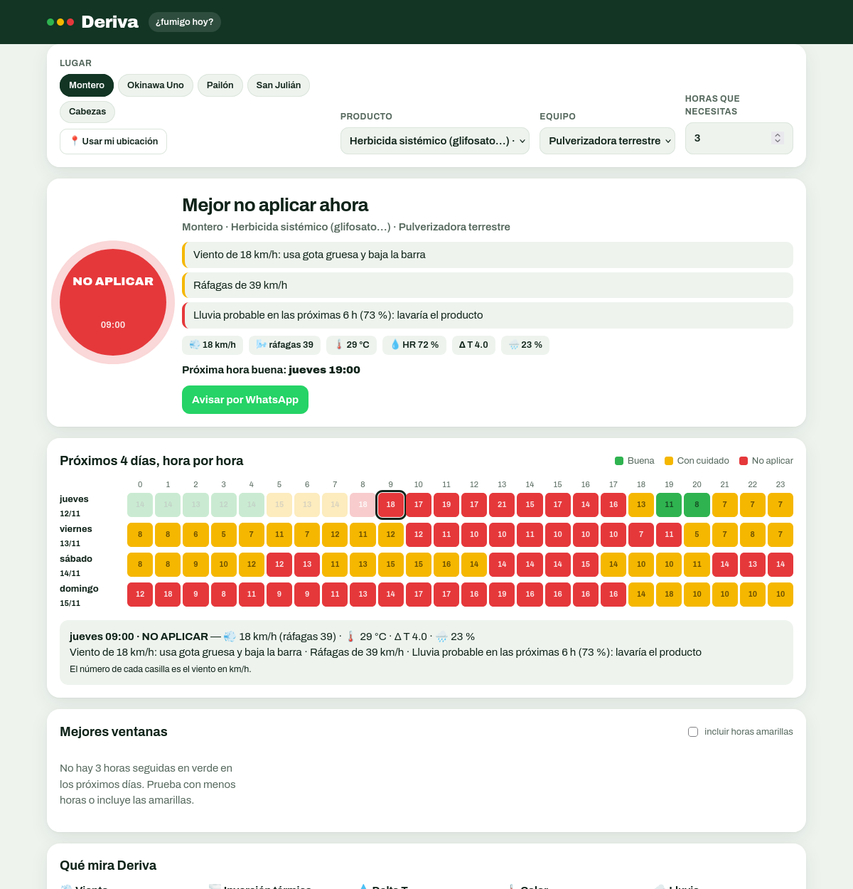
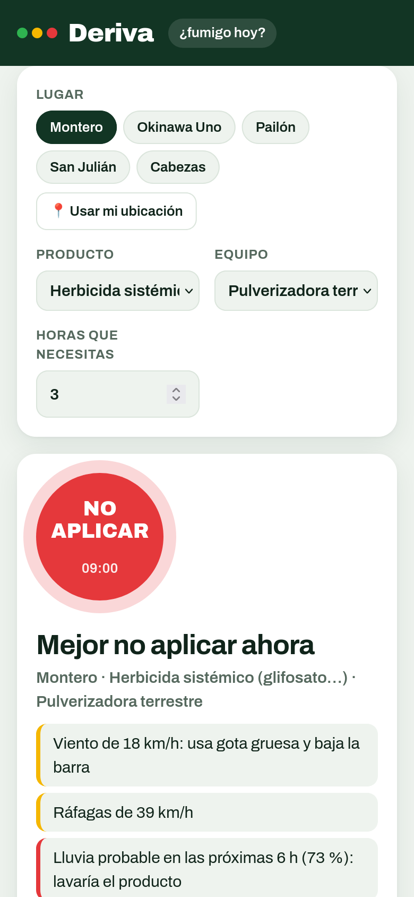

<div align="center">



### Verde, amarillo o rojo: cuándo sí y cuándo no pulverizar, hora por hora, para tu lote.

<a href="https://neckhurtttt.github.io/deriva/"></a>
<a href="#english"></a>




</div>

## 🚜 Para qué sirve

Pulverizar en mal momento es **plata tirada**: el viento se lleva el producto al lote del vecino, el aire seco evapora la gota,
la lluvia lo lava antes de que haga efecto o una inversión térmica deja la nube flotando kilómetros.
**Deriva** mira el pronóstico de tu lote y te dice, **hora por hora**, si conviene aplicar.

- **Semáforo de ahora** con las razones en palabras simples y cuándo es la próxima hora buena.
- **Grilla de 4 días × 24 horas** en verde, amarillo y rojo, con el viento en cada casilla. Tocas una hora y ves el detalle.
- **Mejores ventanas**: tramos de horas seguidas que alcanzan para terminar tu lote (tú dices cuántas horas necesitas).
- Cambia según el **producto** (sistémico, de contacto, hormonal, fungicida, insecticida) y el **equipo** (pulverizadora o dron).
- **Avisar por WhatsApp** al tractorista o al encargado con un toque.
- Funciona con tu **ubicación** o con zonas de Santa Cruz, y guarda la elección en el enlace para compartir.

## 🚦 Las reglas

| Qué mira | 🟢 Bien | 🟡 Con cuidado | 🔴 No aplicar |
|---|---|---|---|
| 💨 Viento | 3 a 15 km/h (12 con dron) | 15 a 20 km/h | más de 20 km/h |
| 🌬️ Ráfagas | hasta 30 km/h | 30 a 40 km/h | más de 40 km/h |
| 🌫️ Inversión térmica | con viento | menos de 3 km/h de día con nubes | menos de 3 km/h de noche o con cielo limpio |
| 💧 Delta T | 2 a 8 | menos de 2 o 8 a 10 | más de 10 |
| 🌡️ Temperatura | hasta 29 °C | 29 a 32 °C | más de 32 °C (28 °C los hormonales) |
| 🌧️ Lluvia | sin lluvia en el tiempo de lavado | 30–60 % de probabilidad | lloviendo o ≥ 60 % antes del lavado |

**Delta T** es la diferencia entre la temperatura del aire y la de bulbo húmedo (calculada con la fórmula de Stull, 2011).
Mide qué tan rápido se evapora la gota. El **tiempo de lavado** va de 1 h (contacto) a 6 h (sistémicos y hormonales).

> Es una guía basada en buenas prácticas de aplicación. Siempre manda la **etiqueta del producto** y lo que ves en el lote.

<div align="center"></div>

## ▶️ Usar

**En el celular o la compu:** https://neckhurtttt.github.io/deriva/

```sh
python3 -m http.server 8000   # http://localhost:8000
npm test                      # 9 pruebas de las reglas (Node 20+)
```

Si no hay internet, muestra el último pronóstico guardado de ejemplo (`data/demo.json`).

## 🗂️ Estructura

- `js/spray.js`: las reglas (viento, ráfagas, inversión, Delta T, calor, lluvia antes del lavado), las ventanas y la lectura del pronóstico.
- `js/app.js`: semáforo, grilla, ventanas, ubicación y WhatsApp.
- Pronóstico: [Open-Meteo](https://open-meteo.com/) (datos abiertos, sin clave, licencia CC BY 4.0).

Es parte de las herramientas agro junto a [Surco](https://github.com/NeckHurtttt/Surco) (qué rotación sembrar)
y [AgroControl](https://github.com/NeckHurtttt/AgroControl) (registro del campo).

<a id="english"></a>
## 🌎 English

**Deriva** (Spanish for *drift*) is a spray-timing traffic light for farmers. For any location it fetches a 4-day hourly
forecast and rates every hour green/amber/red using wind speed, gusts, temperature-inversion risk, **Delta T** (Stull
wet-bulb), heat (stricter for hormonal herbicides) and rain within the product's rainfast period. It lists the best
continuous spray windows, adapts to product and equipment (boom sprayer or drone) and shares a summary via WhatsApp.
[Open it](https://neckhurtttt.github.io/deriva/).

<div align="center">

**Hecho por [NeckHurtttt](https://github.com/NeckHurtttt)** · Santa Cruz, Bolivia 🇧🇴

<sub>mirar el cielo · mirar la etiqueta · recién pulverizar</sub>

</div>
